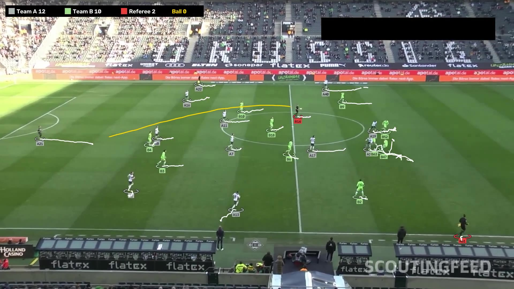
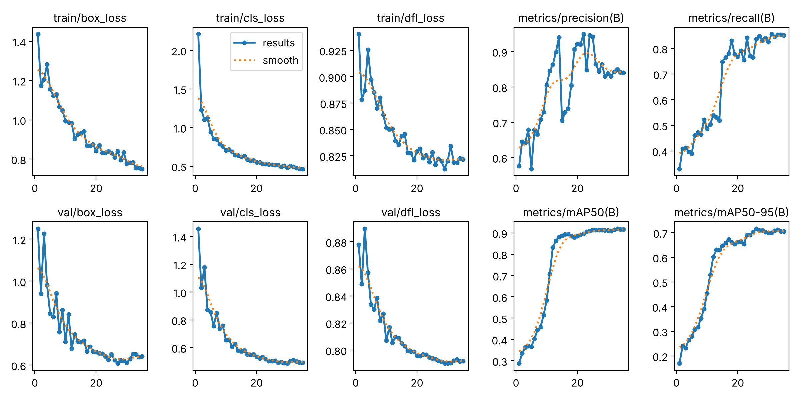

# ⚽ football YOLOv8: 공 · 선수 · 심판 감지와 추적, 팀 구분

**직접 수집·라벨링한 축구 경기 이미지 143장**으로 COCO 사전학습 **YOLOv8n**을 fine-tuning했습니다.
부류는 **ball, player, referee** 3개입니다.
학습한 모델로 5초 경기 영상에서 객체를 감지·추적하고, 유니폼 색으로 선수를 두 팀으로 나눴습니다.



- 추적 결과 영상: [`results/tracking_5s.mp4`](results/tracking_5s.mp4) (5초, 125프레임, 1920×1080)
- 학습된 모델: [`weights/best.pt`](weights/best.pt) (6.5 MB)
- 객체별 궤적: [`results/trajectories.csv`](results/trajectories.csv) (`frame, track_id, class, team, cx, cy, w, h, conf`)

## 1. 데이터 수집 (직접 수집, 143장)
공개된 경기 영상 4개에서 일정 간격으로 프레임을 뽑았습니다.

| 경기 | 원본 | 프레임 간격 | 이미지 | 심판복 |
|---|---|---|---:|---|
| m1 묀헨글라트바흐 vs 볼프스부르크 (**시연 경기**) | DFL `08fd33_4.mp4`, 30초 | 15 | 40 | 검정 |
| m2 우니온 베를린 vs 볼프스부르크 | DFL `121364_0.mp4`, 30초 | 20 | 38 | 검정 |
| m3 마인츠 vs 검정 유니폼 팀 | DFL `cut_1.mp4`, 30초 | 20 | 38 | 노랑 |
| m4 맨체스터 시티 vs 맨체스터 유나이티드 | `CityUtdR.mp4`, 10.7초 | 10 | 27 | 검정 |

- **시연 구간 제외:** 시연 영상은 m1의 10~15초(프레임 250~374)입니다. 학습 데이터에는 이 구간과 앞뒤 여유(프레임 235~389)를 넣지 않았습니다.
- **학습/검증 분할:** 경기마다 영상 마지막 구간을 검증용으로 뗐습니다. 학습 120장, 검증 23장입니다.

### 라벨링 (반자동 + 육안 검수)
1. 보조 검출기로 사람·공 박스 후보를 만듭니다(Roboflow 자동 라벨과 같은 역할). `scripts/dataset/1_collect_frames.py`
2. 경기별 심판복 색 규칙으로 referee 후보를 고릅니다. 상의 Lab 색 기준으로 m1·m2·m4는 검정, m3는 노랑입니다. 후보를 모두 잘라 한 장에 모아 **눈으로 검수**했습니다. `2_review_referee_candidates.py`
3. 검수에서 나온 수정을 반영해 YOLO 라벨을 만듭니다. `3_build_labels.py`
   - 수정 내용: 홈 골키퍼(검은 계열)·그늘 속 선수 등 referee로 잘못 잡힌 21건을 player로, 코치·벤치 스태프는 삭제, 관중석 물체 등 잘못된 공 후보 4건은 제외

| 분할 | 이미지 | ball | player | referee |
|---|---:|---:|---:|---:|
| train | 120 | 38 | 2,204 | 154 |
| val | 23 | 6 | 451 | 33 |
| 합계 | **143** | 44 | 2,655 | 187 |

## 2. 학습
| 항목 | 값 |
|---|---|
| 모델 | YOLOv8n (`yolov8n.pt`, COCO pretrained) |
| 데이터 | 직접 수집한 데이터만 사용 (`data/own_dataset`) |
| Epochs / imgsz / batch | 35 / 960 / 4 (마지막 5 epoch mosaic off) |
| Optimizer | AdamW (Ultralytics auto) |
| 선택 | 26 epoch (`best.pt`, 검증 mAP50-95 최고) |
| 환경 | CPU 2코어, 8 GB RAM, Ultralytics 8.4 (epoch당 약 2.3분, 총 약 80분) |

```bash
pip install -r requirements.txt
python scripts/train.py            # data/own_dataset 으로 학습
```
데이터셋을 처음부터 다시 만들려면 아래 순서로 실행합니다.
```bash
bash scripts/dataset/get_videos.sh                                   # 원본 영상 4개 다운로드
python scripts/dataset/1_collect_frames.py --helper weights/public_stage2_best.pt
python scripts/dataset/2_review_referee_candidates.py m1             # m1~m4 각각 검수용 이미지
python scripts/dataset/3_build_labels.py
```

## 3. 성능
**자체 검증셋 23장** (4개 경기의 마지막 구간)
| 부류 | Precision | Recall | mAP50 | mAP50-95 |
|---|---:|---:|---:|---:|
| 전체 | 0.865 | 0.837 | 0.914 | 0.717 |
| player | 0.896 | 0.960 | 0.975 | 0.830 |
| referee | 0.866 | 0.727 | 0.872 | 0.730 |
| ball | 0.831 | 0.824 | 0.894 | 0.590 |



- 검증 라벨도 학습 라벨과 같은 반자동 방식으로 만들었습니다. 그래서 박스 위치가 보조 검출기와 비슷한 쪽으로 유리할 수 있습니다. 공은 검증셋에 6개뿐이라 수치가 불안정합니다.
- **처음 보는 경기** 기준 성능도 따로 쟀습니다. 공개 데이터셋 val 100장(다른 6개 경기, 다른 심판복 색)에서 mAP50 0.614, mAP50-95 0.355가 나왔습니다(player 0.956 / referee 0.593 / ball 0.294, mAP50 기준). 경기 4개만으로 학습해서 낯선 심판복이나 공에는 약합니다.

**시연 5초 영상**
| 항목 | 결과 |
|---|---|
| 주심을 referee로 표시 | 125 / 125 프레임 |
| 골키퍼를 player로 표시 | 전 구간 (Team A) |
| 공 감지 | 79 / 125 프레임 |
| Team A (흰색, 골키퍼 포함) / Team B (연두) | 트랙 16 / 12개, 프레임당 평균 11.7 / 8.9명 |

## 4. 객체 감지 + 추적 + 팀 구분
```bash
python scripts/track.py --weights weights/best.pt --source input/match_5s.mp4 \
    --out results/tracking_5s.mp4 --csv results/trajectories.csv
```
- **player / referee**: `model.track(..., tracker="bytetrack.yaml", persist=True, agnostic_nms=True)`로 추적합니다.
  - `agnostic_nms=True`: 기본 NMS는 부류별로 돌아서, 한 사람에게 player 박스와 referee 박스가 겹쳐 나올 수 있습니다. 부류 구분 없이 NMS를 돌려 사람당 박스를 1개로 만듭니다.
  - 트랙 ID마다 confidence 가중 **분류 다수결**로 한 사람의 부류를 고정합니다. 5프레임 미만으로 나타난 트랙(오검출)은 지웁니다.
- **팀 구분** (2-pass): 1차로 감지·추적하면서 선수마다 상의 색을 모읍니다(상체 Lab 중앙값, 잔디색 픽셀 제외). 그다음 트랙별 색의 **색상 성분(a, b)으로 K-means(k=2)** 를 돌려 팀을 나눕니다. 밝기(L)는 그늘·햇빛에 따라 바뀌므로 뺐습니다. 2차로 영상을 그립니다.
- **ball**: 10px 안팎이라 1280 해상도로 따로 감지하고, 프레임당 1개만 고릅니다. 프레임당 60px(최대 300px) 넘게 튀는 검출은 버리고, 8프레임 넘게 끊긴 궤적은 잇지 않습니다.
- **궤적 저장**: 강의 예제는 궤적을 화면에만 그립니다. 코드를 고쳐 모든 객체의 좌표를 프레임별로 CSV에 저장했습니다.
- 표시: 팀 색 타원·라벨(A=흰 팀, B=연두 팀), 빨강 R=심판, 흰 선=사람 궤적, 노란 선·삼각형=공, 좌상단에 팀별 인원 수

## 5. 저장소 구조
```
├── data/
│   ├── own_dataset/            # 직접 수집·라벨링한 143장 (images/, labels/, data.yaml)
│   └── public_dataset.yaml     # (실험용) 공개 데이터셋 설정
├── input/match_5s.mp4          # 시연용 5초 영상
├── results/
│   ├── tracking_5s.mp4, trajectories.csv, tracking_frame.jpg
│   ├── train/                  # 학습 곡선, 혼동행렬, PR 곡선, epoch별 수치
│   └── experiments/            # 이전 실험(공개 데이터셋 학습) 기록
├── scripts/
│   ├── dataset/                # 영상 다운로드 → 프레임 수집 → 검수 → 라벨 생성
│   ├── train.py                # 학습
│   └── track.py                # 감지 + 추적 + 팀 구분 + 궤적 저장
└── weights/
    ├── best.pt                 # 최종 모델 (직접 수집 데이터)
    └── public_stage*_best.pt   # 이전 실험 모델 / 라벨링 보조 검출기
```

## 6. 출처
- 경기 영상: [Dayallenr/Football-Tracking-and-Analysis-System](https://github.com/Dayallenr/Football-Tracking-and-Analysis-System) · [Hazrat-Ali9/Real-Time-Football-Player-Team-Tracking](https://github.com/Hazrat-Ali9/Real-Time-Football-Player-Team-Tracking) · [ConnorSiXiong/Kaggle_DFL_BundesligaDataShootout](https://github.com/ConnorSiXiong/Kaggle_DFL_BundesligaDataShootout) · [Mostafa-Nafie/Football-Object-Detection](https://github.com/Mostafa-Nafie/Football-Object-Detection)
- 라벨링 보조 검출기 학습에 쓴 공개 데이터셋: [skaczylo/football-image-dataset](https://github.com/skaczylo/football-image-dataset) (CC BY 4.0)
- Ultralytics YOLOv8: https://github.com/ultralytics/ultralytics · [Train](https://docs.ultralytics.com/modes/train/) · [Track](https://docs.ultralytics.com/modes/track/)
